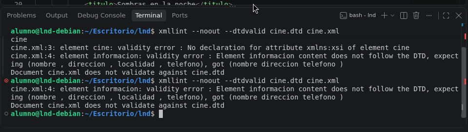
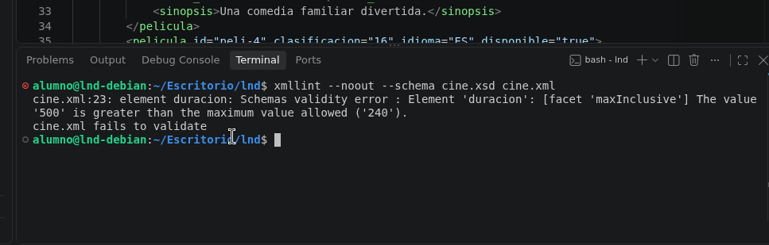

# Reto final de la unidad: Gestión de un cine

- Práctica final de la unidad 3 de creación de xml, dtd y xsd.

## Comandos utilizados en la práctica

- Comando para verificar un archivo xml con su dtd correspondiente.

```
xmllint --noout --dtdvalid cine.dtd cine.xml
```

- Comando para verificar un archivo xml con su xsd correspondiente usado en la práctica.

```
xmllint --noout --schema cine.xsd cine.xml
```

## Capturas de pasos realizados

- Captura de la validación del dtd


- Captura de la validación de xsd


- Captura del error en el dtd con elemento eliminado


- Captura del error en el xsd con el elemento eliminado
